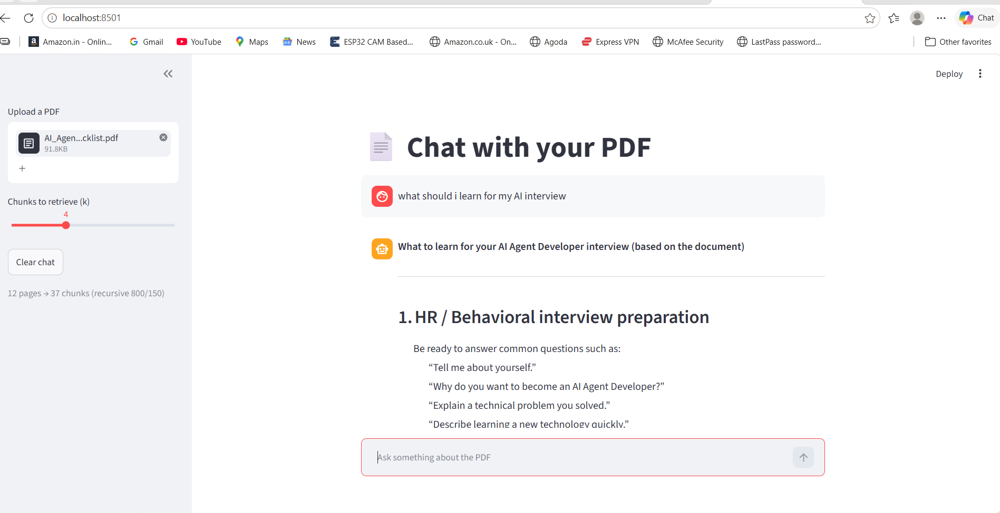

# 📄 Chat with your PDF (RAG)

A document Q&A chatbot built with Retrieval-Augmented Generation (RAG). Upload a PDF, ask questions in chat, and get answers that come **only from the document**, with **page-level source citations**.

**Live demo:** <add your Streamlit link here>



## Features

- **Source citations:** every answer shows the page number and a snippet of the text it used
- **Chat memory:** follow-up questions are rewritten into standalone questions before searching
- **Clause-aware chunking:** for clause-numbered policy documents (e.g. `HR-1.2`), each topic's clauses are kept together in one chunk with the page footer removed. Other PDFs automatically fall back to a recursive text splitter (800 characters, 150 overlap)
- **MMR retrieval:** returns relevant chunks that are also different from each other, reducing repeated results
- **Hallucination guard:** the prompt restricts the model to the retrieved context and makes it say "I couldn't find that in the document" when the answer is not there
- **Adjustable retrieval:** a sidebar slider controls how many chunks are retrieved

## Tech stack

| Part | Tool |
|---|---|
| Framework | LangChain |
| PDF loading | PyPDF |
| Embeddings | HuggingFace `all-MiniLM-L6-v2` (runs locally, free) |
| Vector store | FAISS |
| LLM | Groq, Llama 3.3 70B (free tier) |
| UI | Streamlit |

## How it works

```
PDF -> pages -> chunks -> embeddings -> FAISS index
                                            |
Question -> (rewrite if follow-up) -> MMR retrieval -> top-k chunks
                                                          |
                                      LLM (answers only from chunks) -> answer + sources
```

## Project structure

```
rag-pdf-chatbot/
├── app.py                  # Streamlit app
├── requirements.txt
├── README.md
├── .gitignore
├── notebooks/
│   └── rag_pdf_chatbot.ipynb   # step-by-step build and experiments
├── data/
│   └── Nexora_Policy_Handbook_1120_clauses.pdf   # synthetic sample document
├── tests/
│   └── nexora_test_set.csv     # 100 questions with expected answers
└── screenshots/
    └── demo.png
```

## Run locally

1. Clone the repo and enter the folder:
   ```bash
   git clone <your-repo-url>
   cd rag-pdf-chatbot
   ```
2. Create and activate a virtual environment:
   ```bash
   python -m venv venv
   venv\Scripts\activate        # Mac/Linux: source venv/bin/activate
   ```
3. Install dependencies:
   ```bash
   pip install -r requirements.txt
   ```
4. Get a free API key at [console.groq.com](https://console.groq.com).
5. Start the app:
   ```bash
   streamlit run app.py
   ```
6. Paste your Groq key in the sidebar, upload a PDF, and start asking questions.

**Optional:** to avoid pasting the key each time, create `.streamlit/secrets.toml` containing `GROQ_API_KEY = "your_key"`. This file is listed in `.gitignore` and must never be committed.

## Sample document and test set

`data/Nexora_Policy_Handbook_1120_clauses.pdf` is a synthetic 82-page company policy handbook (20 sections, 280 topics, 1,120 clauses). All company details and figures are fictional. The text is highly templated, so many clauses look almost identical, which makes it a good stress test for retrieval.

`tests/nexora_test_set.csv` contains 100 questions with known answers, the gold clause ID, and the expected page, plus 4 out-of-scope questions that should return "I couldn't find that in the document".

Example questions to try:
- What is the maximum limit for language training?
- Who must approve exceptions to the work from abroad policy?
- Which form must I submit to initiate petty cash?
- Who is the CEO of Nexora? (should be refused)

## Evaluation

Retrieval hit rate = the top-k chunks contain both the correct clause and the correct answer value.

| Chunking | Chunks | Retrieval hit rate (top 4) |
|---|---|---|
| Recursive 800 / 150 | <fill in> | <fill in> |
| Clause-aware (one chunk per topic) | 280 | <fill in> |

Answer accuracy on a 30-question sample: `<fill in>`
Out-of-scope questions correctly refused: `<fill in> / 4`

*(Replace the placeholders with results from your own runs of the test cells in the notebook.)*

## Limitations

- Works on text-based PDFs only (scanned images need OCR first)
- Handles one PDF at a time
- Tables, charts and images are not understood
- The clause-aware chunker and footer removal are tuned to the sample handbook's format; other documents use the generic splitter, which has not been tuned for them
- Ambiguous questions (e.g. "What is the maximum limit for leave?") can match several near-identical clauses

## Future improvements

- Multi-PDF support
- Reranking and hybrid (BM25 + vector) search
- Automated evaluation with RAGAS
- OCR support for scanned documents
- Word and TXT file support

## License

MIT
